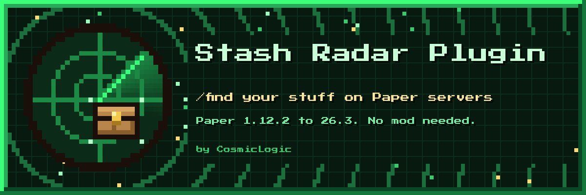

**`/find diamond`. That's it.**

> ⚠️ **Requires [LogicLib Plugin](https://www.curseforge.com/minecraft/bukkit-plugins/logiclib-plugin).** Put it in your `plugins` folder too.

Your players lose things in chests all the time. **Stash Radar Plugin** lets them type `/find` and see exactly which nearby chests, barrels and shulker boxes have the item. **This is the server-plugin version of the [Stash Radar](https://www.curseforge.com/minecraft/mc-mods/stash-radar) mod.** Players need **no mods**: it works with a normal Minecraft client.

---

🧩 **One jar for Paper 1.12.2 to 26.3.**

## 🔥 What it does

### 🔎 /find with tab-complete
`/find diamond`, `/find oak log`, `/find minecraft:emerald 24`. Tab-complete suggests item names, and a typo gets a "did you mean" list.

### ✨ Particle outlines only the searcher sees
Matching containers get a particle outline for a few seconds, sent to that one player only (no particle spam for everyone else).

### 🧭 Count, distance and direction
"Found 23 Diamond in 3 containers. Nearest: 6 blocks north-east."

### 📦 Looks inside shulker boxes
Placed shulker boxes and shulker box items stored in chests both count.

### 🛡️ Fair by default
The server reads the real containers in chunks that are already loaded (it never loads chunks). Locked containers are skipped unless a player has the bypass permission. A cooldown stops spam.

### ⚙️ Configurable
Range, max range, cooldown, which containers are searched, highlight time, color and outline limit, and every message: all in `config.yml`.

## 🔐 Commands and permissions
| Command | Permission | Default |
|---|---|---|
| `/find <item> [range]` (also `/stashfind`, `/sfind`) | `stashradar.find` | everyone |
| No cooldown | `stashradar.bypass.cooldown` | op |
| Also search locked containers | `stashradar.bypass.locked` | op |
| `/stashradar reload` | `stashradar.admin` | op |

## 📦 Requirements
- **Paper** 1.12.2, 1.16.5, 1.18.2, 1.19.2, 1.20.1, 1.21.1, 1.21.11, 26.1, 26.2, 26.3 (every one tested on a real server)
- **Requires [LogicLib Plugin](https://www.curseforge.com/minecraft/bukkit-plugins/logiclib-plugin)** (shared code for my plugins). The plugin won't start without it.
- What's different from the mod: no search screen (tab-complete instead) and no modded containers. Everything else works the same.

Source and bug reports: https://github.com/CosmicLogic0/stashradar-plugin

---

## ❤️ Support the plugin

Stash Radar is free. Donations keep it up to date with fixes, new Minecraft versions and new features. [Donate with PayPal](https://www.paypal.com/paypalme/DylanEMason) - any amount helps. Thank you!

---

## 🎮 Play on the creator's server
**Logic Survival** (`play.logicsurvival.fyi`) is the survival server run by the maker of this plugin. The plugin doesn't add anything to anyone's server list.
